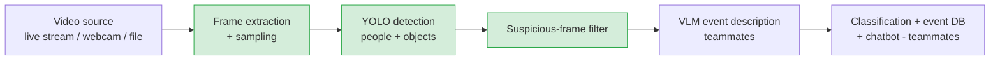

# Live Video Event Detection: Frame Processing and YOLO Detection

**My part of a team project for the Honeywell hackathon (October 2026).**

The team built an open-source system that watches a live video stream, detects and tracks people and objects, describes events with a vision-language model, classifies them (person down, fighting, tailgating, crowd incident, suspicious activity) and lets users query stored events in natural language.

**This repo contains the stage I built:** turning video into frames, running YOLO detection, and filtering suspicious frames for the next stage.

## Where my part fits

Note on data

No Honeywell data is included. The demo uses a public sample video from [source link].

Tech stack

Python · OpenCV · [Ultralytics YOLOv8] · NumPy

Team

Built during the Honeywell hackathon with my teammates. My contribution: frame extraction, YOLO detection and suspicious-frame filtering.
